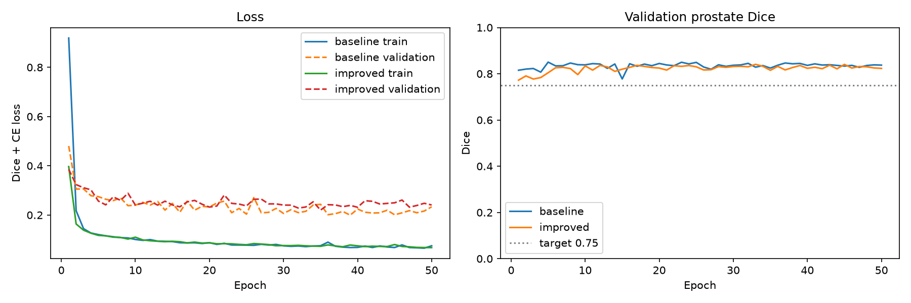
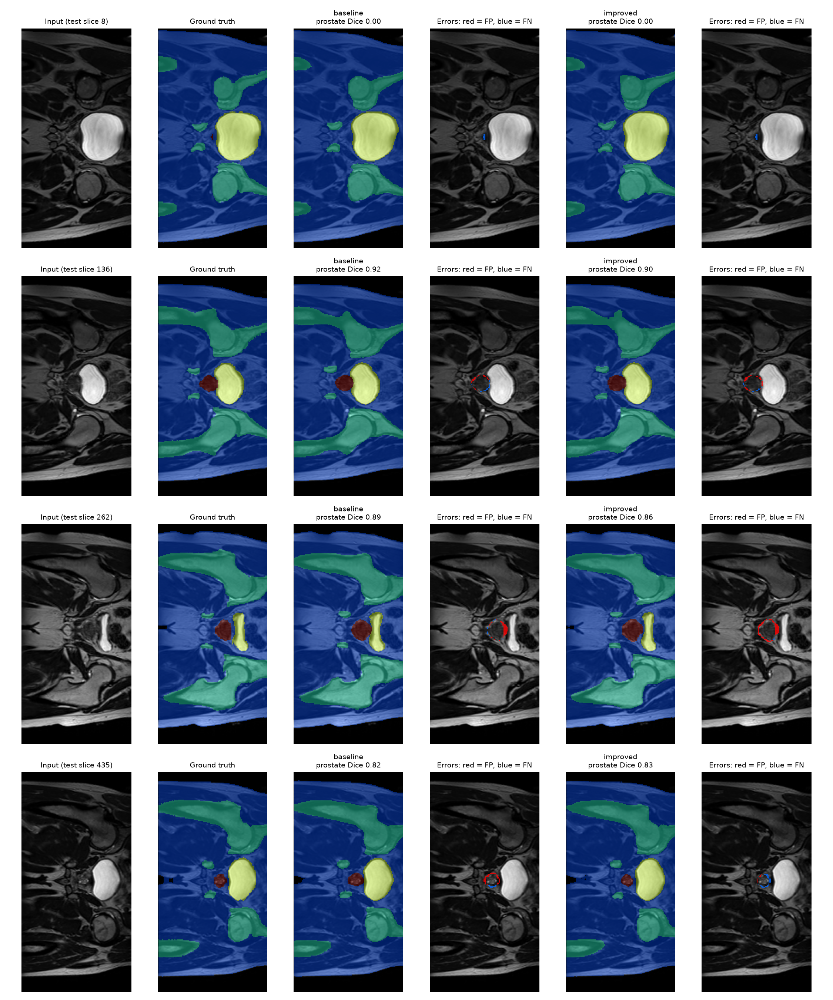
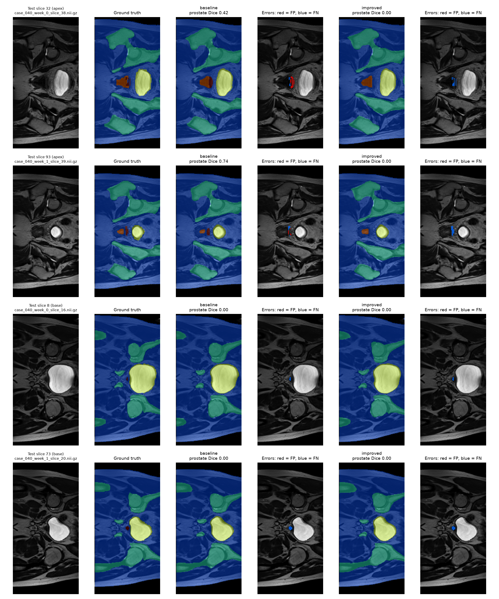

# 1. Problem and The Algorithm

This project addresses task 2.2 which revolves around external-beam radiotherapy for prostate cancer depending on accurate contours of the prostate and organs at risk around it. If a contour is too small, tumours may be missed. Drawing these contours by hand on every MRI slice is too slow so this project builds an annotation assistant by proposing a draft segmentation for a clinicians to review and correct. The model is a 2D improved U-Net(Isensee et al., 2018), trained on 2D slices from the HipMRI study to label every pixel as one of six classes: background, body, bone, bladder, rectum or prostate. Segmenting the prostate is difficult because it occupies less than 2% of a pelvic scan and its edges, especially at the base and apex, have low contrast against neighbouring tissue.This model is compared with the standard 2D U-Net on the same data.

The ImprovedUNet2D is an encoder-decoder with skip connections. The encoder has five levels with 16, 32, 64, 128 and 256 feature channels and the first level works at full 258x128 resolution where each level below starts with a stride-2 convolution that halves the image size and doubles the channels down to 16×8. Every level then applies a context block which contains two convolutions with instance normalization, leaky ReLU and the decoder upsamples the feature to full size. At each level, the matching encoder features concatenates and merges with a localization block, a 3x3 convolution followed by a 1x1 convolution. For deep supervision, 1×1 segmentation and full resolution are each resized to full resolution and summed into the final output. This gives the lower decoder levels a direct training signal. The output has 6 channels and each pixel takes the class with the highest score. Both models are trained with cross-entropy plus soft Dice loss.

The baseline UNet2D uses the same five levels and channel width. Each level is a plain double convolution with batch normalisation and ReLU, downsampling uses max-pooling, upsampling uses transposed convolutions, and there is a single output head.

# 2. Feasibility Review

## Intended users

The intended user is a radiology oncology staff contouring prostate and organs at risk for radiotherapy planning. The purpose of this prototype is to draft 2D contours for an expert to review and correct. A high global Dice can hide boundary failures at the prostate base/apex and leakage into the rectum or bladder. This prototype tests whether the Improved U-Net's multi-scale design reduces those failures compared with a plain 2D U-Net, or only improves the easy central slices.

## Acceptance Criteria

1. Prostate dice ≥ 0.75 across all test set
2. Boundary quality reported per class should be better than or equal to the baseline
3. Inference ≤ 50 ms per slice; peak training VRAM ≤ 8 GB
4. Organs at risk Dice ≥ 0.8

## Model Choice & Course Concepts

The data used will be the HipMRI 2D slices dataset containg training/validation/test and 11,460/660/540, with no patient overlap. The choice of model will be the 2D improved U-net model with residual context modules, instance norm, leaky ReLU, localisation modules and deep supervision will be used. This model will be compared with baseline the standard 2D U-net that will be trained on the same dataset. Course concepts used will be dice plus entropy-loss, residual learning, normalization, and encoders-decoders.

## Feasibility Evidence

The baseline 2D U-Net was trained for 5 epochs on the full training set on an NVIDIA RTX 3070 Laptop GPU (8 GB). Training Loss fell from 0.92 to 0.12 and prostate Dice reached 0.85 by epoch 5 which is is above the 0.75 target. On the other hand, the 2D Improved U-Net reached 0.77 validation prostate Dice after a single epoch.

## Technical Risks

1. Limited GPU memory (8 GB laptop)
2. Image–mask misalignment
3. Class imbalance: prostate is < 2% of pixels
4. Patient leakage between splits

## Compute Budget

Training runs on an NVIDIA RTX 3070 Laptop GPU (8 GB). Rangpur is the backup if the laptop is unavailable or too slow.

## Next planned experiment

Train the baseline 2D U-Net and the 2D Improved U-Net for 50 epochs each with identical splits, loss, optimiser (Adam, lr 5e-4) and seed. Then compare test per-class Dice and IoU, prostate boundary F1, and apex / mid / base Dice, and inspect 3–5 boundary failure cases.

## Fallback

If the Improved U-Net doesn't reach 0.75 prostate Dice, tune the loss weighting and learning rate or crop to the pelvic region of interest.

# 3. Dependencies

| Package    | Used for                                                      |
| ---------- | ------------------------------------------------------------- |
| Python     | dataset.py, modules.py, train.py, predict.py                  |
| PyTorch    | models, training, inference                                   |
| NumPy      | data loading (dataset.py) and plotting only, not in the model |
| nibabel    | reading NIfTI (.nii.gz) slices                                |
| matplotlib | training curves and prediction figures                        |
| tqdm       | progress bars while loading data                              |

Installation:
conda create -n comp3710 python=3.11 -y
conda activate comp3710
pip install torch numpy nibabel matplotlib tqdm

# 4. Dataset and Pre-Processing Used

## 4.1 Dataset

This project uses the 2D slice version of the HipMRI Study prostate dataset. It is provided on the Rangpur cluster at /home/groups/comp3710/HipMRI*Study_open/keras_slices_data. Files are named case*<patient>_week_<week>_slice_<slice>.nii.gz, and each mask has the same name with seg* in place of case*. Patients were scanned in several weeks and each scan contributes to many consecutive slices.

| Split      | Slices | Slice size                     |
| ---------- | ------ | ------------------------------ |
| Train      | 11,460 | 11,400 × 256×128, 60 × 256×144 |
| Validation | 660    | 256×128                        |
| Test       | 540    | 256×128                        |

These numbers were retrieved from a data audit through the use of the following code:

python3 -c "
import glob, nibabel as nib
from collections import Counter
for folder in ['keras_slices_train', 'keras_slices_validate', 'keras_slices_test']:
print(folder, Counter(nib.load(i).shape for i in glob.glob(folder + '/_.nii_')))
"

## 4.2 Preprocessing For Both Models

1. Loading. Slices are read with nibabel using the load_data_2D and to_channels functions from Appendix B of the course specification.
2. Fixed size. 11,400 training slices and all validation and test slices are 256x128. The 60 trainign 256*144 are center cropped to 256*128 by removing 8 columns from each side. The mask gets exactly the same crop. Masks are loaded with the same load_data_2D function, and each wide image has a wide mask.
3. Intensity. Each slice is z-score normalized.
4. Labels. Masks are stored as integer class labeled 0-5. These labels represent ("background", "body", "bone", "bladder", "rectum", "prostate"). They are one-hot encoded into 6 channels.
5. Augmentation. A left-right flip applied to both image and mask and a random brightness and contrast change applied to the image only with both a probability of 0.5. Validation and test slices are not augmented.

# 5. Training Setup

Both models are trained by train.py in one run, using the same loaders and settings. The architecture is the only difference.
| Setting | Value |
|---|---|
| Loss | Cross-entropy + soft Dice|
| Optimiser | Adam, learning rate 5×10⁻⁴, weight decay 1×10⁻⁵ |
| Batch size | 16 slices |
| Epochs | 50 per model |
| Random seed | 35 (`torch.manual_seed`) |
| Checkpoint selection | Epoch with the highest validation prostate Dice |
| Hardware | NVIDIA GeForce RTX 3070 Laptop GPU (8 GB) |

Optimiser. The learning rate of 5×10⁻⁴ and weight decay of 1×10⁻⁵ follow the settings used by Isensee et al. (2018) for the original Improved U-Net. The same values were then applied to the baseline model.

Checkpointing. After every epoch the model predicts the whole validation set, and the validation loss and prostate Dice are recorded. Once the validation prostate Dice beats the best one, the weights are saved to output/<model>\_best.pt. After training, the best weights are reloaded and used for all test results, so later epochs that overfit cannot make the reported model worse.

Figure 2: Dice + cross-entropy loss (solid = training, dashed = validation) and validation prostate Dice for both models over 50 epochs

Training Curves. Both models learn most of what they will learn in the first 5 epochs. For the baseline model, training loss drops from 0.9 to about 0.14 by epoch 5, then falls slowly to about 0.08 by epoch 50. For the improved model, training loss drops from 0.4 to about 0.15 by epoch 5, then falls slowly to about 0.07 by epoch 50.

Target Dice. The validation prostate Dice is above 0.75 from the first epoch and settles around 0.82 to 0.85 for both models. The improved U-Net starts lower with around 0.78 at epoch 1 and catches up around epoch 6.

Training length. Since neither model improved significantly after 10 epochs, 50 epochs were more than needed since 20 epochs would've given the same result.

# 6. Investigation of the Open Research Dilemma

## 6.1 Quantitative Benchmarking:

| Label                       | Baseline Dice | Baseline IoU | Improved Dice | Improved IoU | Δ Dice (Improved − Baseline) |
| --------------------------- | ------------- | ------------ | ------------- | ------------ | ---------------------------- |
| Background                  | 0.9964        | 0.9929       | 0.9971        | 0.9943       | +0.0007                      |
| Body                        | 0.9844        | 0.9693       | 0.9849        | 0.9702       | +0.0005                      |
| Bone                        | 0.9362        | 0.8801       | 0.9366        | 0.8808       | +0.0004                      |
| Bladder                     | 0.9617        | 0.9262       | 0.9653        | 0.9330       | +0.0036                      |
| Rectum                      | 0.8513        | 0.7411       | 0.8688        | 0.7680       | +0.0175                      |
| **Prostate**                | **0.8561**    | **0.7485**   | **0.8448**    | **0.7314**   | **−0.0113**                  |
| Mean (excluding background) | 0.9179        | 0.8530       | 0.9201        | 0.8567       | +0.0022                      |

| Model          | Prostate boundary F1 |
| -------------- | -------------------- |
| Baseline U-Net | **0.8906**           |
| Improved U-Net | 0.8681               |

Both the baseline and and the improved 2D U-Net achieved the Dice target of 0.75. As shown above, the test prostate Dice for the baseline was 0.856 and 0.845 for the improved Dice. The improved Dice did not improve the prostate, with a worse performance on prostate Dice(-0.011) and prostate boundary F1(-0.023). It can be concluded that the extra multiscale context, residual blocks, and deep supervision did not produce more accurate prostate contours. Based on the deltas, the differences are minimal, with 0.02 Dice or less.

Prostate Dice for the four example slices in Figure 3:
| Test slice | Baseline | Improved |
|---|---|---|
| 8 | 0.000 | 0.000 |
| 136 | 0.919 | 0.902 |
| 262 | 0.888 | 0.857 |
| 435 | 0.822 | 0.834 |

Exampe predictions:

Figure 3: Predictions of Four Test Slices

Prostate Dice by position:
| Slice group | baseline prostate Dice | improved prostate Dice |
|---|---|---|---|
| apex | 0.3857 | 0.3095 |
| mid | 0.8682 | 0.8511 |
| base | 0.0339 | 0.0000 |

Based on the prostate Dice by position, global Dice hides hides catastrophic failure at the ends of the gland. Although both models pass the 0.75 target, the base and apex prostate is essentially never found. In fact, the improved 2D U-Net is lower than the baseline in every group, with the biggest at apex(0.31 vs 0.39). Thus, even with advanced multi-scale context, the problem isn't fixed.

## 6.2 Resource Profiling

| Model          | Parameters | Peak training VRAM (GB) | Time per epoch, profiled (s) | Actual training time, 50 epochs | Inference (ms/slice) |
| -------------- | ---------- | ----------------------- | ---------------------------- | ------------------------------- | -------------------- |
| Baseline U-Net | 1,943,846  | 0.74                    | 35.2                         | 90 min                          | 1.62                 |
| Improved U-Net | 3,189,746  | 1.44                    | 95.4                         | 412 min                         | 1.49                 |

The data above was measured on an NVIDIA GeForce RTX 3070 Laptop GPU (8 GB), batch size 16. Peak VRAM and time per epoch were measured over one epoch (training and validation) for each model with `profile_models.py`, under the same conditions, to provide fair comparisons. Actual training times were recovered from the file timestamps of the full run and they were 3–5× longer than the profile and grew during the run, which points to thermal throttling or power saving on the laptop over the 8.3-hour run. The improved 2D U-Net trained overnight under these conditions which led to a longer cost ratio.

## 6.3 Failure-case Autopsy

Figure 4: Failure Autopsy Of Four Apex and Base Slices

1. Apex, test slice 38. Improved U-Net(Dice 0.00)
   This slice is the apex of the prostate where a small region is pressed against the rectum. The improved 2D U-Net doesn't predict any prostate but instead, labels the whole area as rectum. There is a class confusion happening in the improved model. Since the apex is the narrow end of the gland with little contrast against the rectal wall, the rectum is the much larger neighbor.

2. Apex, test slice 93. Improved U-Net(Dice 0.00)
   This slice comes from the same patient one week after with a smaller prostate between the rectum and the bladder.The Improved U-Net again labels the area as rectum and body, and misses the prostate entirely. Similar to the first case, there is a prostate-to-rectum confusion.

3. Base, test slice 8. Both Models(Dice 0.00)
   In this slice, the bladder is full and the ground truth contains a tiny fragment of prostate a the bladders edge. Both models label the rest of the slice correctly, but completely misses the fragmenet. The root trigger comes from the target being extremely tiny and the base of the prostate seems like it merges together with the bladder.

Pattern:
On middle slices, the models can produce close contours with thin boundary errors. However, the serious failures occur at the end of the glands where the prostate is small and pressed against a larger organ. At the base, both models miss the prostate beside the bladder and at the apex, the improved 2D U-Net absorbs the prostate into the rectum.

## 6.4 Recommendation for project manager

Recommendation: use the baseline 2D U-Net since the extra cost of the Improved 2D U-Net is not justified for prostate contouring.
| Consideration | Baseline U-Net | Improved U-Net |
|---|---|---|
| Prostate accuracy | Slightly better (Dice 0.856, boundary F1 0.891) | Slightly worse (0.845, 0.868) |
| Apex / base prostate Dice | 0.39 / 0.03 | 0.31 / 0.00 |
| Organs at risk | Slightly worse on rectum | Slightly better on rectum (+0.018) |
| Parameters | 1.9 M | 3.2 M |
| Training memory and time(NVIDIA GeForce RTX 3070 Laptop GPU (8 GB)) | 0.74 GB, ~29 min | 1.44 GB, ~80 min |
| Inference speed | 1.62 ms/slice | < 1..49 ms/slice |

# 7. Artificial Intelligence Usage Disclosure

**Tools used**
I used Claude(Anthropic)
**What It helped with**
I used AI throughout this project, as a coding assistant and report-drafting tool. I used it to understand the assignment, the HipMRI data and the Improved U-Net architecture, and it scaffolded the code in dataset.py, train.py, predict.py and profile_models.py, which I then reviewed, adapted, and debugged with its help. I also used it to set up my environment to interpret my training log, results tables and failure-case figures, and to draft some sections of this README from my code and results. The experiments themselves were run by me on my own machine and every number, table and result figure in this report comes from those runs. I checked the AI's code by running it on the real data and checked the report's numbers against my outputs.

**How I checked and verified it**

- I ran a shape check on every image and mask file on Rangpur. It showed that 11,400 training slices are 256×128 and 60 are 256×144, that all validation and test slices are 256×128, and that the mask folders have identical counts, so each image and its mask receive the same crop.
  -Checked the file naming so that every image is paired with its own mask.
- Checked the code against the specification, for example whether the visualisations show input, ground truth, prediction and false-positive/false-negative overlays, and whether the failure analysis covers base and apex slices, and had missing parts added
  -Ran every script on the real data on my own GPU. This surfaced errors in the suggested and merged code.
  -Read the training log and curves for signs of a problem: both losses fall, validation loss levels off rather than rising, and validation Dice is stable above the target

# 8. References

[1] F. Isensee, P. Kickingereder, W. Wick, M. Bendszus, and K. H. Maier-Hein, “Brain Tumor Segmentation and Radiomics Survival Prediction: Contribution to the BRATS 2017 Challenge,” Brainlesion: Glioma, Multiple Sclerosis, Stroke and Traumatic Brain Injuries, pp. 287–297, 2018. DOI: 10.1007/978-3-319-75238-9_25.
