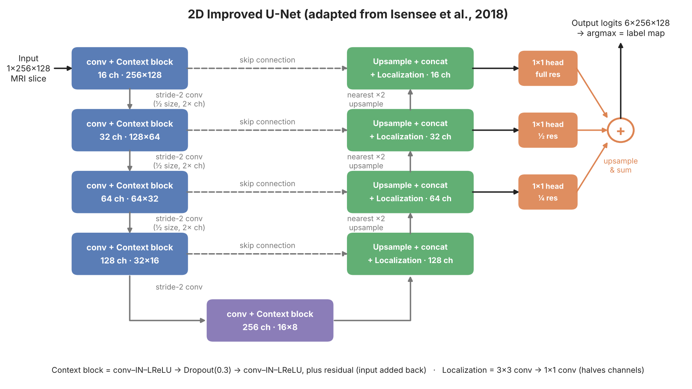

# 1. Problem and The Algorithm

This project addresses task 2.2 which revolves around external-beam radiotherapy for prostate cancer depending on accurate contours of prostate and organs at risk around it. If a contour is too small, tumours may be missed. Drawing these contours by hand on every MRI slice is too slow so this project builds an annotation assistant by proposing a draft segmentation for a clinicians to review and correct. The model is a 2D improved U-Net(Isensee et al., 2018), trained on 2D slices from the HipMRI study to label every pixel as one of six classes: background, body, bone, bladder, rectum or prostate. Segmenting the prostate is difficult because it occupies less than 2% of a pelvic scan and its edges, especially at the base and apex, have low contrast against neighbouring tissue.This model is compared with the standard 2D U-Net on the same data.

The ImprovedUNet2D is an encoder-decoder with skip connections. The encoder has five levels with 16, 32, 64, 128 and 256 feature channels and the first level works at full 258x128 resolution where each level below starts with a stride-2 convolution that halves the image size and doubles the channels down to 16×8. Every level then applies a context block which contains two convolutions with instance normalization, leaky ReLU and the decoder upsamples the feature to full size. At each level, the matching encoder features concatenates and merges with a localization block, a 3x3 convolution followed by a 1x1 convolution. For deep supervision, 1×1 segmentation and full resolution are each resized to full resolution and summed into the final output. This gives the lower decoder levels a direct training signal. The output has 6 channels and each pixel takes the class with the highest score. Both models are trained with cross-entropy plus soft Dice loss.

The baseline UNet2D uses the same five levels and channel width. Each level is a plain double convolution with batch normalisation and ReLU, downsampling uses max-pooling, upsampling uses transposed convolutions, and there is a single output head.

# 2. Feasibility Review

Intended users:
The intended user is a radiology oncology staff contouring prostate and organs at risk for radiotherapy planning. The purpose of this prototype is to draft 2D contours for an expert to review and correct. A high global Dice can hide boundary failures at the prostate base/apex and leakage into the rectum or bladder. This prototype tests whether the Improved U-Net's multi-scale design reduces those failures compared with a plain 2D U-Net, or only improves the easy central slices.

Acceptance Criteria:

1. Prostate dice ≥ 0.75 across all test set
2. Boundary quality reported per class should be better than or equal to the baseline
3. Inference ≤ 50 ms per slice; peak training VRAM ≤ 8 GB
4. Organs at risk Dice ≥ 0.8

Model Choice & Course Concepts
The data used will be the HipMRI 2D slices dataset containg training/validation/test and 11,460/660/540, with no patient overlap. The choice of model will be the 2D improved U-net model with residual context modules, instance norm, leaky ReLU, localisation modules and deep supervision will be used. This model will be compared with baseline the standard 2D U-net that will be trained on the same dataset. Course concepts used will be dice plus entropy-loss, residual learning, normalization, and encoders-decoders.

Feasibility Evidence:
The baseline 2D U-Net was trained for 5 epochs on the full training set on an NVIDIA RTX 3070 Laptop GPU (8 GB). Training Loss fell from 0.92 to 0.12 and prostate Dice reached 0.85 by epoch 5 which is is above the 0.75 target. On the other hand, the 2D Improved U-Net reached 0.77 validation prostate Dice after a single epoch.

Technical Risks:

1. Limited GPU memory (8 GB laptop)
2. Image–mask misalignment
3. Class imbalance: prostate is < 2% of pixels
4. Patient leakage between splits

Compute Budget:
Training runs on an NVIDIA RTX 3070 Laptop GPU (8 GB). Rangpur is the backup if the laptop is unavailable or too slow.

Next planned experiment:
Train the baseline 2D U-Net and the 2D Improved U-Net for 50 epochs each with identical splits, loss, optimiser (Adam, lr 5e-4) and seed. Then compare test per-class Dice and IoU, prostate boundary F1, and apex / mid / base Dice, and inspect 3–5 boundary failure cases.

Fallback:
If the Improved U-Net doesn't reach 0.75 prostate Dice, tune the loss weighting and learning rate or crop to the pelvic region of interest.

# 3.

# Artificial Intelligence Usage Disclosure
